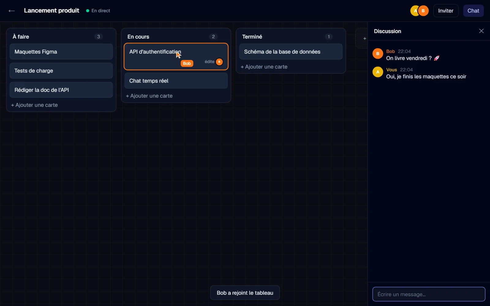
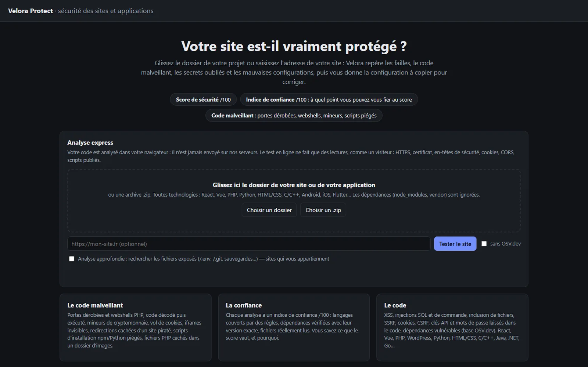
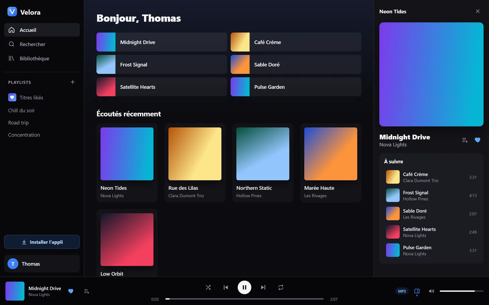
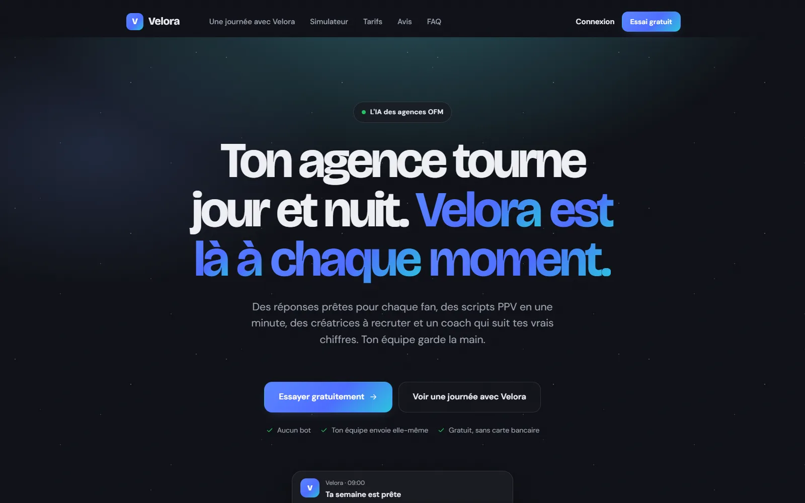

<picture>
  <source media="(prefers-color-scheme: dark)" srcset="assets/banniere-dark.svg">
  
</picture>

  
  

## 👋 Bonjour

<picture>
  <source media="(prefers-color-scheme: dark)" srcset="assets/bonjour-dark.svg">
  
</picture>

## 🚀 Projets

<table>
  <tr>
    <td width="50%" valign="top">
      
      <h3><a href="https://github.com/zeoftdpro/velora-board">Velora Board</a></h3>
      Kanban collaboratif en <b>temps réel</b> : curseurs en direct, glisser-déposer synchronisé, chat, et gestion des modifications simultanées.
        
      <code>Next.js</code> <code>Express</code> <code>Socket.io</code> <code>PostgreSQL</code> <code>Redis</code>
        
      <a href="https://velora-board.vercel.app">▶ Voir la démo</a> · <a href="https://github.com/zeoftdpro/velora-board">Code source</a>
    </td>
    <td width="50%" valign="top">
      
      <h3><a href="https://github.com/zeoftdpro/velora-protect">Velora Protect</a></h3>
      Outil de <b>sécurité</b> pour les projets de code : failles, secrets oubliés, code malveillant, test des sites en ligne, sauvegardes vérifiées et preuve d’antériorité.
        
      <code>Python</code> <code>Pyodide</code> <code>JavaScript</code> <code>OSV.dev</code>
        
      <a href="https://velora-protect.vercel.app">▶ Voir le site</a> · <a href="https://github.com/zeoftdpro/velora-protect">Code source</a>
    </td>
  </tr>
  <tr>
    <td width="50%" valign="top">
      
      <h3><a href="https://github.com/zeoftdpro/velora-musique">Velora Musique</a></h3>
      <b>Streaming musical</b> sur le web, Windows et Android : lecteur HLS adaptatif, file d’attente, playlists et recherche instantanée.
        
      <code>React</code> <code>TypeScript</code> <code>Fastify</code> <code>PostgreSQL</code> <code>Electron</code>
        
      <a href="https://velora-musique.vercel.app">▶ Voir le site</a> · <a href="https://github.com/zeoftdpro/velora-musique/releases/latest">⬇ Télécharger</a> · <a href="https://github.com/zeoftdpro/velora-musique">Code source</a>
    </td>
    <td width="50%" valign="top">
      
      <h3><a href="https://velora-ofm.vercel.app">Velora Agent IA</a></h3>
      <b>Assistant IA</b> pour les agences de créatrices : copilote qui propose des réponses aux chatters, scripts de vente, prospection, formation et coach chaque semaine.
        
      <code>Node.js</code> <code>API LLM</code> <code>Supabase</code> <code>Stripe</code> <code>Electron</code>
        
      <a href="https://velora-ofm.vercel.app">▶ Voir le site</a> · code privé (produit commercial)
    </td>
  </tr>
</table>

Les autres projets (Velora Drive, Velora IDE, Garry’s Mod) sont présentés sur <a href="https://thomas-delhay.vercel.app">mon portfolio</a>.

## 🧰 Langages et outils

<b>Langages</b> 
<picture>
  <source media="(prefers-color-scheme: dark)" srcset="https://skillicons.dev/icons?i=cs,html,css,lua&theme=dark">
  
</picture>

<b>Aussi pratiqués</b> 
<picture>
  <source media="(prefers-color-scheme: dark)" srcset="https://skillicons.dev/icons?i=js,py,cpp,postgres&theme=dark">
  
</picture>

<b>Frameworks et outils</b> 
<picture>
  <source media="(prefers-color-scheme: dark)" srcset="https://skillicons.dev/icons?i=nodejs,react,electron,vite,git,vercel,supabase&theme=dark">
  
</picture>

## 📫 Me contacter

Une proposition d’alternance, de stage ou un projet ? Écris-moi à **[zeoftd.pro@gmail.com](mailto:zeoftd.pro@gmail.com)** ou via le formulaire de [mon portfolio](https://thomas-delhay.vercel.app/#contact) : je réponds sous 48 heures.
